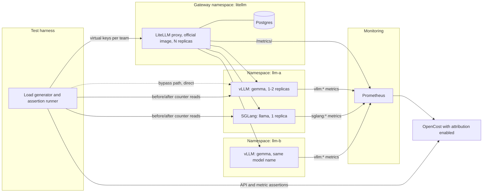

# Integration Test Plan: Inference Cost Attribution with LiteLLM as the Gateway

Author(s): @simanadler

**Status:** Draft

This plan describes how to verify, end to end, the attributed inference cost capabilities (`tenant_id`, `workload_id`, `user_id`) with an official [LiteLLM](https://github.com/BerriAI/litellm) proxy as the metering gateway in front of self-hosted engines (vLLM and SGLang).

It tests two contracts together:

- the **serving-stack side**, as specified in the [Inference Attribution Requirements](../inference-attribution-requirements.md) (LiteLLM as the producer, Section 10 selection checklist, Section 9 conformance table), and
- the **OpenCost side**, as specified in the [Inference Cost Attribution Plan](../inference-cost-attribution-plan.md) (join, remainder, coverage, API, authorization).

It builds on the measurements @sugix posted on [opencost/opencost#3952](https://github.com/opencost/opencost/pull/3952) (official LiteLLM v1.108.4 in front of vLLM 0.31.0 and SGLang, GKE, 2x NVIDIA L4), and is written so that those measurements become regression tests rather than one-off observations.

Related: [Automated Testing in OpenCost](./AUTOMATED_TESTING.md) (unit versus integration split and the pipeline this plan fits into).

**Dimensions in scope.** The baseline configuration (V0, Section 4.2) enables all three: **tenant**, **workload** and **user**. `user_id` is stored as a Prometheus label, on the assumption that the number of distinct users is low. Large user populations are out of scope and listed as future work in Section 15. Variants V3 (user off) and V7 (workload off) exist to prove that disabling a dimension changes nothing else.

---

## 1. Goals and non-goals

**Goals**

1. Show that attributed tokens from LiteLLM reconcile with the engines' own counters, case by case (Section 9 of the requirements).
2. Show that OpenCost turns those tokens into correct per-tenant cost, and that tenant rows plus `__unmetered__` equal the model's cost under both cost bases (the two release gates of the attribution plan, Section 1.7).
3. Pin down, with an automated test, every place where LiteLLM does **not** meet the contract, so each gap is either tracked upstream or compensated for in configuration, and does not silently regress.
4. Exercise the failure modes that produce *silently wrong money*: namespace mislabel, model-name mismatch, counter reset, double counting, forged identity, unmetered bypass.

**Non-goals**

- Cost of SaaS models, or LiteLLM's own spend/price-list figures (requirements Section 1, Rate ownership; Section 2, Scope). They appear only as *negative* tests (they must not leak into attributed cost).
- Unit-level behaviour already covered by the test tables in the attribution plan (Section 1.10). This plan covers behaviour that needs a real Prometheus, a real gateway and real engine counters.
- GPU performance benchmarking.
- Gateway comparison. Envoy AI Gateway is a separate run of the same Phase 1 suite (Section 11).

---

## 2. What is already known (inputs from #3952)

| Source | Finding | How this plan uses it |
|---|---|---|
| @sugix, point 1 | LiteLLM OTel spans carry the team (`metadata.user_api_key_team_alias`), and span tokens matched engine counters exactly, streams included | G-01, G-02: exact-match assertion, no tolerance |
| @sugix, point 1 | `gen_ai.response.model` holds the client's alias, so the served model is read from `gen_ai.request.model` ([BerriAI/litellm#51029](https://github.com/BerriAI/litellm/issues/51029)) | G-04, P-04: assert which attribute/label equals the engine `model_name` |
| @sugix, failure measurement | Gateway timeout after prefill: engine counted +1,447 prompt and +453 generated tokens, LiteLLM span has ERROR and **no `gen_ai.usage`** ([BerriAI/litellm#51221](https://github.com/BerriAI/litellm/issues/51221)) | G-06 (expected failure today, tracked) |
| @sugix, failure measurement | Killed-engine-mid-stream run was inconclusive (stream finished before the kill) | G-09: forced long generation, kill only after N chunks |
| @sugix, point 2 | SGLang uses `sglang:prompt_tokens_total`; in prefill/decode disaggregation both workers report the full prompt, so reference must exclude `engine_type="decode"` | O-14 |
| @sugix, point 3 | Same model in two namespaces drops model cost (#4162, fixed by #4163) | P-01 prerequisite, O-09 |
| @sugix, point 4 | Tenant rows plus remainder must add up to model cost | O-03 (release gates) |
| Attribution plan §1.9 | LiteLLM mapping: `litellm_input_tokens_metric_total`, `litellm_output_tokens_metric_total`, tenant label `team_alias`, `model` label, scrape path `/metrics/`, sentinel `"None"`, no dedicated workload label, no deployment namespace label, no estimated series. The plan's example leaves `workloadLabel` and `userLabel` empty; this test plan turns both on | The configuration under test (Section 4). P-08 establishes which counter labels carry workload and user |
| @noyitz review | Cache-read tokens priced at full input rate; `usage_captured=false` has no aggregate channel; namespace default; per-user authorization | O-17, G-05/G-06 (observable only through the `__unmetered__` row), O-08, A-01..A-04 |

Two items in the plan are explicitly marked *unconfirmed* and are first-class test objectives rather than assumptions:

1. What value `team_alias` holds for a request whose key has no team (the plan assumes `"None"`). See G-03.
2. Whether `user`/`end_user` can be asserted by the client in the request body (LiteLLM accepts a caller-supplied `user`). If it can, `user_id` is **client-asserted**, not gateway-verified, and the forged-identity test (G-10) must say so. See G-10.

---

## 3. Test topology



The harness has **three read channels**, which are what makes this an integration test rather than a smoke test:

| Channel | Used as | Notes |
|---|---|---|
| Engine `/metrics` directly (pod port-forward, bound to `127.0.0.1`) | **Oracle** for tokens actually processed | Read before and after each case, exactly as @sugix did. Independent of Prometheus scrape timing |
| LiteLLM `/metrics/` and Prometheus | What OpenCost will consume | Compared against the oracle |
| OpenCost API and `llm_dimension_*` metrics | System under test | Compared against the oracle and against OpenCost's own model-level rates |

### 3.1 Environments

| Tier | Engines | Purpose | When |
|---|---|---|---|
| **A. Simulated** (kind or similar) | An engine simulator that exposes `vllm:*` counters and OpenAI-style `usage` with controllable token counts and latencies (for example `llm-d-inference-sim`; confirm that it emits `model_name`, `prompt_tokens_total` and `generation_tokens_total` before relying on it) | Fast, deterministic, no GPU. Covers OpenCost logic, namespace resolution, reset, double counting, authorization | Every PR touching `pkg/inferencecost` or the prom source (can be wired into the merge queue stage described in `AUTOMATED_TESTING.md`) |
| **B. Real engines on GPU** (GKE lab offered by @sugix: vLLM 0.31.0, SGLang, 2x L4, llm-d router optional) | Real vLLM and SGLang | Truth for tokenization, prefix cache, timeout-after-prefill and mid-stream kill. Covers G-05..G-09, G-14, O-14 | Pre-release and on LiteLLM/engine version bumps; manual or scheduled, not per PR |

Tier A cannot prove G-06 or G-14: it can only prove OpenCost's handling once those facts exist. Treat Tier B as authoritative for any case marked **[B]**.

### 3.2 Versions and provenance

- Pin LiteLLM, vLLM, SGLang and Prometheus to the **latest stable** release at the start of each run and record the exact versions and image digests in the run report. Do not carry a pin forward without checking it is still maintained and has no open critical CVE (project security policy: no EOL or extended-support-only components).
- Images follow the project container policy for the lab (trusted source, minimal base, non-root, scanned). Deviations for the third-party LiteLLM image are recorded in the report with the reason.
- All port-forwards and local services bind to `127.0.0.1`. LiteLLM master key, virtual keys, the HMAC secret for hashed `user_id` and any Prometheus credentials come from Kubernetes secrets or environment variables, never from committed files. Add test config directories to `.gitignore`.

---

## 4. Configuration under test

### 4.1 LiteLLM

- Official proxy image, `callbacks: ["otel", "prometheus"]` (as measured by @sugix).
- Metrics served at `/metrics/` (trailing slash); Prometheus scrape job configured accordingly. A scrape of `/metrics` without the slash is a known mistake and is covered by P-02.
- `prometheus_exclude_labels` drops `user_email` (requirements Section 4.2).
- **Dimension sources.** Each dimension has a different source in LiteLLM, which determines how trustworthy it is:

| Dimension | LiteLLM source | Set by | Trust |
|---|---|---|---|
| `tenant_id` | Team alias of the virtual key | Gateway admin | Verified (key-derived) |
| `workload_id` | Key alias of the virtual key (one key per workload). The counters have no dedicated workload label, so P-08 confirms the label that carries it | Gateway admin | Verified (key-derived) |
| `user_id` | The `user` field of the request body (`end_user`), set by the calling application | Caller | **Caller-asserted** unless the application is trusted (G-10b) |

- Teams and virtual keys, created by the harness through the admin API. Each key has a team alias (tenant) and a key alias (workload). Users are supplied per request in the body `user` field:

| Key alias (workload) | Team alias (tenant) | Users sent | Purpose |
|---|---|---|---|
| `rag` | `acme-corp/engineering` | alice, bob, carol, none | Tenant value containing `/` (aggregation key collision) |
| `engineering/rag` | `acme-corp` | alice, dave | Collision partner: `(acme-corp/engineering, rag)` vs `(acme-corp, engineering/rag)` |
| `batch` | `acme-corp/engineering` | bob | Second workload under the same tenant |
| `chat` | `globex` | erin, frank, none | Ordinary second tenant |
| `agent` | `globex` | erin | Second workload under the second tenant |
| `noteam-key` (no team, no key alias) | none | none | Missing identity case |
| `limited` | `limited` | none | Rejected-before-inference and rate-limit cases |

The O-19 matrix (3 tenants x 2 workloads x 3 users) adds the keys it needs on top of these, created by the harness.

- Model list maps client aliases to served models, including: a plain alias, an alias that **rewrites** to a different served model, and a SaaS model entry (stub upstream, no GPU).
- 2 LiteLLM replicas for the multi-replica and restart cases (O-11); 1 replica elsewhere.

### 4.2 OpenCost

The baseline enables all three dimensions. It starts from the producer mapping in the attribution plan, Section 1.9, with `workloadLabel` and `userLabel` switched on. The plan's own example leaves both empty because the counters carry no workload label, so the workload and user label names below are **to be confirmed by P-08** and pinned before any other case runs:

```yaml
producers:
  - name: litellm-gateway
    inputTokensSeries: litellm_input_tokens_metric_total
    outputTokensSeries: litellm_output_tokens_metric_total
    tenantLabel: team_alias
    workloadLabel: api_key_alias     # hypothesis: key alias carries the workload; confirmed or replaced by P-08
    userLabel: end_user              # hypothesis: body "user" lands on end_user; confirmed or replaced by P-08
    modelLabel: model
    namespaceLabel: deployment_namespace
    identitySentinel: "None"         # confirmed or replaced by G-03
    userSentinel: "None"
    scope:
      servingModels: [gemma-4-31B]   # per suite; SaaS entry is excluded by this scope
```

OpenCost-side settings for the baseline: `INFERENCE_ATTRIBUTION_ENABLED=true`, and `INFERENCE_ATTRIBUTION_USER_AGGREGATION_ENABLED=true` for the suites that exercise per-user queries (A-04 also runs with it off). `ADMIN_TOKEN` is set for the admin-authenticated calls.

**Low-cardinality assumption.** The baseline stores `user_id` as a Prometheus label. The user population in the lab is deliberately small (tens of users), which is what the plan's design assumes for this phase. S-01 measures how far that holds, and Section 15 lists the follow-up for large user populations.

Configuration variants exercised by name in the cases below: **V0** the baseline above (tenant, workload and user on); **V1** `namespaceLabel: namespace` (the wrong, scrape-target value); **V2** `INFERENCE_ATTRIBUTION_NAMESPACE_MAP` set; **V3** `userLabel: ""` (user dimension off, the fallback for high cardinality); **V4** no `scope`; **V5** `excludeServingModels` instead of `servingModels`; **V6** two producers (LiteLLM plus a second metering source) with and without `scope`; **V7** `workloadLabel: ""` (tenant-only, the attribution plan's own LiteLLM example).

OpenCost must include opencost/opencost#4163 (model cost keyed by namespace) and the SGLang engine queries from #4161. Whether the reset-aware engine-side delta prerequisite has landed is recorded per run, because it decides whether coverage and over-attribution results in reset windows are *authoritative* or *advisory* (attribution plan Section 1.5).


### 4.3 Required LiteLLM changes

LiteLLM is the system under test, so what it needs is part of the plan. The changes fall into three groups. Group A is configuration only and is needed for the baseline to run at all. Group B is code and closes the gaps Phase 1 is designed to expose. Group C is optional. Facts below were read from LiteLLM `main` and the linked issues and pull requests on 2026-11-16, and **P-09 re-verifies every setting name against the pinned version**, since names can differ between releases.

#### Group A: configuration only (official LiteLLM, no code change)

The existing counters `litellm_input_tokens_metric` and `litellm_output_tokens_metric` already carry the labels the baseline needs: `team_alias` (tenant), `api_key_alias` (workload), `end_user` (user) and `model` (served model). They also carry `requested_model`, `hashed_api_key`, `model_id`, `api_provider`, `team`, `user` and `user_email`.

| # | Setting | Why | Verified by |
|---|---|---|---|
| A1 | `litellm_settings.callbacks: ["otel", "prometheus"]` | Counters feed OpenCost, spans feed the Phase 1 span checks (as measured by @sugix) | P-02 |
| A2 | `litellm_settings.enable_end_user_cost_tracking_prometheus_only: true` | **Without it the `end_user` label is always empty on Prometheus** (`get_end_user_id_for_cost_tracking` returns `None` for the Prometheus service unless this is true), so the user dimension silently disappears. This is the most likely cause of "user_id is always empty" | P-08, O-07 |
| A3 | `litellm_settings.prometheus_end_user_metrics_max_series_per_metric` and `prometheus_end_user_metrics_ttl_seconds`, set to values above the lab's real user count | Bounds the `end_user` series. When the cap is exceeded LiteLLM evicts series and loses their increments since the last scrape, so a cap below the user count **loses tokens per user without any error**. Totals then fall below the engine reference and appear as `__unmetered__` | S-01, O-01 |
| A4 | `litellm_settings.prometheus_exclude_labels: ["user_email"]`, and in production also `hashed_api_key`, `model_id`, `api_provider` | `user_email` is personal data (requirements Section 4.2). The others add cardinality OpenCost does not use, because it groups by tenant, workload, user and model only. Keep `requested_model` in the test environment so G-04 can check a router rewrite | P-02 |
| A5 | Every key has a `key_alias` (the workload) and belongs to a team that has a `team_alias` (the tenant); the harness refuses to create a key without them | A missing alias is emitted as the sentinel and lands in `__unidentified__` (G-03). One key per workload | G-03, O-05 |
| A6 | Callers pass the end user in the request body `user` field (or the `x-litellm-customer-id` header) | Source of `end_user`. Caller-supplied, so it is **not** verified identity (G-10b) | G-10, O-07 |
| A7 | Each deployment is `litellm_params.model: hosted_vllm/<name>` (or `openai/<name>`) where `<name>` equals the engine's served model name, with the engine started with `--served-model-name <name>` | The `model` label must equal the engine's `model_name` metric label (requirements F7). Simana's design assumes the `model` label is provider-qualified; @sugix measured the served name. **P-04 settles which it is.** If it is qualified, the fix is a code change (C4), not an OpenCost workaround | P-04, G-04 |
| A8 | Metrics scraped at `/metrics/` (trailing slash); `general_settings.require_auth_for_metrics_endpoint: true` with a scrape credential held in a Kubernetes secret | Authenticated scrape path (requirements Section 4.1). A scrape credential is never committed | P-03, G-11 |
| A9 | Response caching **off** for the baseline; switched on only for G-12 | Cached replays must not enter attributed counters | G-12 |
| A10 | Two replicas only for O-11, G-16; a database (Postgres) for virtual keys and teams | Trusted identity needs the database (Simana's design, Section 6 item 3) | G-16 |

OpenCost-side mapping for this configuration is in Section 4.2. Nothing in Group A changes OpenCost.

#### Group B: code changes in LiteLLM (required to meet the contract)

These are the places where official LiteLLM does not satisfy the requirements. Each has a Phase 1 case that proves the gap today and will fail when the fix lands, which is the XFAIL-GAP behaviour of Section 5.4. Some of this is already designed in Simana's draft (`docs/inference_attribution_design.md` on the `cost-v2-impl` branch of her fork); the design section is cited where it applies.

| # | Change | Gap it closes | Where (LiteLLM) | Phase 1 case | State |
|---|---|---|---|---|---|
| C1 | **Count failed and timed-out requests in the token counters.** Today `PrometheusLogger.async_log_failure_event` does not increment `litellm_input_tokens_metric`, so a request that fails after prefill is invisible to the counters. Increment the input counter from the tokens LiteLLM already recovers (stream chunks, `combined_usage_object`) | F9: failure after prefill, **gateway timeout after prefill** | `litellm/integrations/prometheus.py` (`async_log_failure_event`, `_increment_token_metrics`) | G-05, G-06, G-09 | Open. Not covered by the upstream fixes below. Design: Simana's Section 3.2 and 3.3 |
| C2 | **Estimated and unknown usage as a separate series.** Emit estimated tokens in a sibling counter (for example `<series>_estimated_total`) or a bounded `estimated` label, never mixed into the exact counter (requirements Section 7.3). Needs a `usage_captured` flag on the logging payload, set where the provider's usage chunk is received | `usage_captured=false` has no aggregate channel (@noyitz point 2) | `litellm/litellm_core_utils/litellm_logging.py`, `streaming_handler.py`, `prometheus.py` | G-05, G-08, O-18 | Open. OpenCost already supports an estimated series in its mapping (plan Section 1.9). Design: Simana's Section 3.3 |
| C3 | **Deployment namespace label.** Add a per-deployment `model_info.inference_namespace` and emit it as `deployment_namespace` on the token counters | F8: removes the approximate proportional split for models that run in more than one namespace | `litellm/types/integrations/prometheus.py`, `prometheus.py`, `router_attempt.py` | O-08, O-09 | Open, optional while OpenCost resolves the namespace (V2 map). Design: Simana's Section 3.2 and 3.6 |
| C4 | **Served-model label equal to the engine's `model_name`.** Only if P-04 shows the `model` label is provider-qualified or an alias. Derive it from the deployment's model with the provider prefix stripped, overridable by `model_info.serving_model` | F7 | `prometheus.py`, `router_attempt.py` | P-04, G-04 | Conditional on P-04. Design: Simana's Section 3.2 |
| C5 | **Export series at zero when an identity first appears**, before its first increment | New-identity burst invisible to `increase()` (requirements Section 7.3) | `prometheus.py` (counter creation per label set) | G-17 | Open |
| C6 | **No replay of cached usage in counters** | Response-cache short circuit (requirements Section 6) | `prometheus.py`, cache hit path | G-12 | Only if G-12 shows replayed usage is counted |
| C7 | **Count once across retries, fallbacks and disconnect dispatch** | Double or zero counting | `litellm/proxy/common_request_processing.py`, `prometheus.py` | G-13, G-08 | Only if G-13 or G-08 shows it. Simana's design pins the dedup behaviour in its tests |

**Already fixed upstream, OTel spans only.** Both are in the `v1.111.0-dev` line and in neither v1.108.9 nor v1.110.0-rc.3:

| Upstream | What it fixes | What it does **not** fix |
|---|---|---|
| BerriAI/litellm#51029, PR #51430 (merged 2026-11-12) | `gen_ai.response.model` carries the provider's model instead of the alias. **Only with `OTEL_SEMCONV_STABILITY_OPT_IN=gen_ai_latest_experimental`** | The default behaviour is unchanged, and the Prometheus `model` label is a different code path |
| BerriAI/litellm#51221, PR #51443 (merged 2026-11-12) | A failed span marks provider usage unknown (`litellm.usage.provider_status=unknown`) and records a separate `litellm.usage.estimated_input_tokens`. Estimates only cover text-only prompts | **The Prometheus counters are untouched**, so G-06 remains a gap on the path OpenCost reads (C1 and C2). Output tokens are not estimated |

Consequences for this plan: the span-based assertions in G-04 and G-06 need a `v1.111.0-dev` image, run as a separate, clearly labelled pre-release job and never as the baseline; the counter-based assertions run on the latest stable. The counter gaps stay XFAIL-GAP until C1 and C2 land.

#### Group C: optional or follow-up

| # | Change | Why optional |
|---|---|---|
| C8 | **Dedicated attributed counters** `litellm_attributed_input_tokens_total` and `litellm_attributed_output_tokens_total` with exactly the labels OpenCost expects (`tenant_id`, `workload_id`, `serving_model`, `namespace`, `user_id`), as in Simana's design Section 3.2. This bundles C1 to C5 and would make the OpenCost mapping label names the defaults | It is the cleaner end state, and it avoids the existing counters' extra labels. It is a larger upstream change than C1 to C5 individually. If adopted, only the `producers` entry in Section 4.2 changes, and the whole suite is rerun unchanged, which is the point of keeping the mapping as configuration |
| C9 | **Keyed hash of `user_id`** (HMAC-SHA256 with an operator secret held in a secret store) instead of plain `end_user` | The baseline stores the plain value in Prometheus for the low-cardinality lab; privacy hardening is in Section 15 |
| C10 | **First-class workload identity** (a workload field on keys, instead of the key alias convention), and a verified-header option with a per-key allowlist | The key alias works if keys are one per workload (Risks, item 2) |
| C11 | **Per-request record sink** (webhook or span attributes using the GenAI names), carrying identity and `usage_captured` | Phase 2 in Simana's design; belongs to the large-user follow-up (Section 15) |

#### Order of work

1. Apply Group A and run Phase 0 and Phase 1 unchanged. This yields the real label census and the sentinel values without any code change.
2. File or confirm upstream issues for C1 and C2 first, since they decide whether G-05, G-06 and G-08 stay XFAIL-GAP. @sugix has offered to implement and test counters upstream; C1 and C2 are the work to hand over.
3. Take C3 to C7 only for the cases that Phase 1 actually shows to be gaps.


---

## 5. Method

### 5.1 Deterministic traffic

Every case must know, before it sends traffic, how many tokens it expects the engine to process.

- Prompts are generated from a fixed corpus and their length is calibrated once per engine and model by sending a request and reading the **engine's** prompt-token delta (not a client-side tokenizer estimate; requirements F4).
- Completion length is forced with `max_tokens` plus `min_tokens`/`ignore_eos` (or the engine's equivalent), so output tokens are known.
- Each case uses its **own team alias or key** (suffix with the run ID) so cases cannot contaminate each other's attributed rows. The remainder (`__unmetered__`) is asserted at the `(model, namespace)` level, so bypass traffic is injected only in cases that expect it.
- Between cases the harness waits until at least **two scrapes** have occurred after the last request (scrape interval is recorded in the run report), because `increase()` omits series with a single sample and the collection window is never widened (attribution plan Section 1.3.2).

### 5.2 Oracle and expected values

For case `c`, on engine `e` serving model `m` in namespace `n`:

```
E_in(c)  = engine_prompt_tokens_total   after - before
E_out(c) = engine_generation_tokens_total after - before
```

| Assertion type | Expected |
|---|---|
| Attributed tokens vs. engine delta, normal path | **Exact equality** (sugix measured exact matches); no tolerance on the gateway counters |
| Attributed tokens vs. engine reference, through OpenCost | Within the configured coverage tolerance (default 0.1 over, threshold 0.9 under) only when scrape-boundary skew is part of the case; otherwise exact after waiting for two scrapes |
| Attributed cost | `in_tokens x inputRate/1e6 + out_tokens x outputRate/1e6`, where the rates are read from **OpenCost's own model-level response** for the same window and basis. Tolerance: relative 1e-6 (float arithmetic only) |
| Reconciliation | `sum over tenant rows + __unmetered__ == model total`, both bases, tolerance 1e-6 relative |

The test never recomputes a rate from first principles: rate ownership belongs to OpenCost (requirements Section 1). It only checks that the join applied that rate correctly.

### 5.3 Window handling

The harness records `T0` before the first request of a case and `T1` after the last scrape wait, then queries OpenCost with the explicit window `[T0, T1]`. Cases never rely on `24h`-style windows, which would include other cases' traffic. A dedicated case (O-12) checks window exactness.

### 5.4 Result states

Each case ends as one of:

| State | Meaning |
|---|---|
| PASS | Expected behaviour observed |
| FAIL | Regression or defect in OpenCost or configuration |
| **XFAIL-GAP(#id)** | Known LiteLLM or engine gap, referenced to an upstream issue. The test asserts the **current wrong behaviour** and the **documented compensation** (for example, the missing tokens land in `__unmetered__`, not with a tenant and not nowhere). When the upstream issue is fixed, the case flips to FAIL until the expectation is updated |
| BLOCKED | Environment or prerequisite missing; reported, not silently skipped |

XFAIL-GAP is the important state. It makes the contract gaps visible and keeps "documented limitation" from drifting into "undocumented regression".

---

## 6. Phase 0: environment and contract checks

Run first. A failure here makes later results meaningless.

| ID | Check | Pass criteria |
|---|---|---|
| P-01 | OpenCost build contains #4163 and #4161 | Same model in two namespaces yields two model-level entries with non-zero cost each (regression for #4162). Record whether reset-aware engine-side deltas are present |
| P-02 | **Label census.** Scrape LiteLLM `/metrics/` after one request per key; list the actual label set on `litellm_input_tokens_metric_total` and `litellm_output_tokens_metric_total` | Contains `team_alias` (or the configured tenant label), `model`; document whether `user`, `end_user`, `requested_model`, `team`, `hashed_api_key`, `api_key_alias` are present; confirm `user_email` is dropped. The census output is attached to the run report and diffed against the previous run, so a LiteLLM upgrade that renames a label is caught immediately |
| P-03 | Scrape path | `/metrics/` scraped, series visible in Prometheus; `/metrics` (no slash) behaviour recorded |
| P-04 | **Served-model equality.** For each model alias, send one request and compare LiteLLM's `model` label value with the engine's `model_name` label | Equal for the plain alias and for the rewrite alias. For the rewrite alias also record `requested_model` and confirm it is **not** in the grouping key. If LiteLLM emits `org/model` where the engine emits `model`, confirm OpenCost's canonicalization joins them (O-15) |
| P-05 | Attribution health check at startup (V0) | No ERROR from the health check; `llm_dimension_unmatched_keys{producer="litellm-gateway"} == 0` after traffic |
| P-06 | Misconfiguration is loud: start with V1 (`namespaceLabel: namespace`) | ERROR log naming the producer, the configured label and the likely cause on the first cycle and every later cycle; `llm_dimension_unmatched_keys > 0` (@noyitz point 3). Reverting to V0 clears it |
| P-07 | Missing series names | Attribution disabled with a startup error; model-level collection unaffected |
| P-08 | **Workload and user label discovery.** With the key matrix of Section 4.1 (distinct team, key alias and body `user`), read which counter labels carry each value | Confirm that the team is on `team_alias`, the workload (key alias) on `api_key_alias`, and the body `user` on `end_user`. LiteLLM also has a `user` label (the key's owning user), which is a different fact: record both. Pin the label names into the mapping of Section 4.2. If a value is not on the counters, the dependent cases (O-05..O-07, O-19, A-02, A-04) are BLOCKED and the gap is filed upstream, not worked around with a client-side label |
| P-09 | **LiteLLM configuration check** (Section 4.3). On the pinned image: (a) every Group A setting name is accepted at startup without an unknown-setting error; (b) `end_user` is non-empty on the counters for a request carrying a body `user`, and empty when `enable_end_user_cost_tracking_prometheus_only` is off (proves A2 is what controls it); (c) `user_email` is absent from the scrape; (d) the `/metrics/` endpoint refuses an unauthenticated scrape when `require_auth_for_metrics_endpoint` is on; (e) record which of the Section 4.3 Group B items are already present in the image, by checking whether the failure path and the estimated series exist | All of (a) to (d) hold. (e) is written into the run report as the "Group B state" table, so XFAIL-GAP expectations in Phase 1 are set from facts about the pinned build and not from this document |


---

## 7. Phase 1: gateway conformance (LiteLLM and engines)

These mirror the Section 9 conformance table of the requirements and are run **without relying on OpenCost cost output**. The assertion is on LiteLLM's counters and spans against the engine oracle. This isolates producer defects from OpenCost defects.

Legend for the "Expected today" column: **PASS** means expected to pass on official LiteLLM v1.108.4 per #3952; **GAP** means expected XFAIL-GAP.

| ID | Case | Procedure | Expected (contract) | Expected today |
|---|---|---|---|---|
| G-01 | Non-stream success, with identity | One request per key, fixed tokens | LiteLLM in/out counters for `team_alias=<team>` increase by exactly `E_in`, `E_out`; span has `gen_ai.usage.input_tokens/output_tokens`; one span | PASS |
| G-02 | Streaming success | `stream=true` with usage in the final chunk | Same as G-01. Record whether LiteLLM injected `stream_options.include_usage` and whether the client received the extra empty-`choices` chunk (requirements Section 6 note) | PASS |
| G-03 | **Missing identity** | (a) `noteam-key` (no team, no key alias). (b) A key with a team but no key alias. (c) A request with no `user` | Each missing dimension appears under a *single, documented* sentinel, never under another tenant, workload or user. **Record the exact label value for each of the three labels**; this resolves the open "confirm what `team_alias` holds without a team" item in the attribution plan and the same question for the workload and user labels. The sentinels are pinned into the OpenCost mapping (`identitySentinel`, `userSentinel`). OpenCost has one `identitySentinel` per producer: if tenant and workload use different sentinels, record it as a GAP | Unconfirmed, discover then pin (`"None"` assumed) |
| G-04 | Router rewrite | Alias rewritten to a different served model | `model` label equals the engine's `model_name` of the model that ran; `requested_model` carries the alias; span: served model readable (from `gen_ai.request.model`, per #51029) | PASS for the counter. Span: GAP on stable builds; fixed on `v1.111.0-dev` only with `OTEL_SEMCONV_STABILITY_OPT_IN=gen_ai_latest_experimental` (BerriAI/litellm#51029, PR #51430) |
| G-05 | Failure after prefill began, before output | Engine error injected after prefill (for example, simulator error mode on Tier A; a fault-injected decode error on Tier B) | Prompt tokens recorded, completion 0, marked `usage_captured=false` | Record behaviour; expected GAP on the counters: the failure path does not increment them (Section 4.3 C1) and there is no aggregate channel for the flag (C2; requirements §7.3 gap raised by @noyitz). The difference lands in `__unmetered__` (O-04) |
| G-06 | **Gateway timeout after prefill** [B] | `request_timeout` 3 s, prompt ~1,450 tokens, long forced generation, non-streamed (exactly @sugix's case) | Prompt tokens not recorded as zero; engine reference still includes them | **GAP on the counters** (Section 4.3 C1, C2): engine +1,447 prompt, LiteLLM counter +0. The span half was fixed upstream (BerriAI/litellm#51221, PR #51443, `v1.111.0-dev` only): a failed span marks usage unknown and carries a separate `litellm.usage.estimated_input_tokens`, so on that image assert the span carries the marker and the estimate, and that the estimate is **not** in `gen_ai.usage.input_tokens`. XFAIL-GAP assertion on the counters: LiteLLM attributed delta is 0 **and** the engine delta is not, **and** (Phase 2, O-04) the difference appears in `__unmetered__`, not with a tenant and not nowhere |
| G-07 | Rejected before inference | Invalid key (401), malformed body, oversized context, key over budget or rate limit | No tokens recorded, engine counters unchanged | PASS expected; verify rate-limit and oversize paths specifically |
| G-08 | Client disconnect mid-stream [B] | Open a long stream, close the socket after N chunks | Prompt tokens recorded; completion flagged unavailable or estimated; tokens the engine generated after the disconnect land in the remainder, not with the tenant | GAP: plan §1.9 notes LiteLLM records streamed-so-far tokens as ordinary usage. XFAIL-GAP assertion: attributed output < engine output, difference visible in `__unmetered__` |
| G-09 | Engine killed mid-stream [B] | Force a long generation (several hundred tokens at least), kill the engine pod only after the Nth received chunk, so the kill cannot lose the race against stream completion (the inconclusive run in #3952) | As G-05/G-08. Record what LiteLLM reports and what the engine reported before dying (engine counters may reset: the case also feeds O-11) | Unknown, discover |
| G-10 | **Forged identity** | (a) Send arbitrary `x-tenant-id` and `x-workload-id` style headers with the `chat` key. (b) Send a body `user` value naming another person. (c) Send a team alias and key alias in the request metadata | (a) and (c): attribution follows the **key's** team and key alias; the forged values appear in no label, span or log. `tenant_id` and `workload_id` must never be forgeable. (b): **determine** whether LiteLLM treats the body `user` as client-asserted. If it does, `user_id` is *reported by the caller*, not verified: it is still attributed (the baseline enables it), but the report and any chargeback built on it must say so, and one caller can attribute usage to another user *within its own tenant and workload*, never to another tenant | Tenant and workload forgery must PASS. User assertion is expected GAP by design (document, do not fail) |
| G-11 | **Unauthorized metrics write** | (a) Unauthenticated `GET /metrics/` on LiteLLM from outside the allowed network path. (b) Attempt to inject a series for another tenant into Prometheus (remote write or Pushgateway without credentials) | (a) Document exposure; attributed series must reach Prometheus only through an authenticated scrape path (requirements Section 4.1). (b) Rejected | Deployment-level; fail if (b) succeeds |
| G-12 | Response-cache short circuit | Enable LiteLLM response caching, send the same request twice | Second request: engine delta 0, attributed delta **0** (replayed usage must not be added again; requirements Section 6) | Probe; LiteLLM may still count cached usage in metrics. If so, XFAIL-GAP with the over-attribution consequence checked in O-10 |
| G-13 | Retries and fallbacks | Make the first backend fail, let LiteLLM retry or fall back to another deployment | Counted **once**; the served `model` is the one that actually ran; engine deltas sum to the attributed total | Probe; PASS expected for the count, check `model` label on fallback |
| G-14 | Engine prefix-cache reuse [B] | Same long prefix across requests | Attributed tokens equal the engine's `usage` including cached tokens (cached is a subset of prompt, F12) | PASS expected. Pricing consequence in O-17 |
| G-15 | SaaS model through the same LiteLLM | Request to a stub SaaS upstream (no GPU, no engine) | Series emitted for it; no engine counters exist for it | PASS (it is emitted). Exclusion is OpenCost's job (O-13) |
| G-16 | Multi-replica and restart | 2 LiteLLM replicas under mixed traffic; then restart one | Each replica exposes its own counter; per-replica `increase()` sums to the engine delta; restarted replica's counter reset does not reduce attributed totals | Drives O-11 |
| G-17 | New-identity burst | A brand-new team sends one short burst between two scrapes | Record whether LiteLLM exports the series at zero before the first increment (requirements Section 7.3). If not, the first burst is invisible to `increase()` | Expected GAP; asserts the documented consequence: tokens land in `__unmetered__` (O-04), not with another tenant |

### 7.1 Selection checklist outcome

The Phase 1 results fill in the five-item checklist in requirements Section 10 for LiteLLM, as a table committed with the run report:

| # | Checklist item | Evidence |
|---|---|---|
| 1 | Token counters carry `tenant_id`, `workload_id`, `serving_model`, deployment namespace, `user_id` optional | P-02, P-08, G-01 (tenant, workload via key alias, user and served model expected present; deployment namespace expected missing: record how it is compensated) |
| 2 | Prompt tokens recorded for failures after prefill (F9) | G-05, G-06 |
| 3 | Streaming without `usage` marked `usage_captured=false` | G-02, G-08 |
| 4 | Missing identity recorded as unattributed, not defaulted | G-03 |
| 5 | `serving_model` equals the engine `model_name` after rewrites | P-04, G-04 |

---

## 8. Phase 2: OpenCost attribution correctness

Run with V0 unless stated. Tier A unless marked [B].

| ID | Case | Procedure | Pass criteria |
|---|---|---|---|
| O-01 | Token coverage | Mixed traffic from three teams through LiteLLM only | `llm_dimension_token_coverage{direction="input"}` and `{direction="output"}` within the tolerance of 1.0, each computed separately |
| O-02 | Join arithmetic | Fixed traffic per team, window `[T0,T1]` | Per row: cost equals `in x inRate + out x outRate` per basis, using OpenCost's own model-level rates (Section 5.2). Both `allocation` and `usage` bases |
| O-03 | **Release gate 1 and 2 (reconciliation)** | Same traffic | (1) `aggregate=model_name` with attribution enabled equals the model-level total on both bases. (2) Sum over `aggregate=tenant_id`, remainder included, equals that same total on both bases. Fails the whole suite if either fails |
| O-04 | **Bypass and remainder** | Send traffic directly to the engine, not through LiteLLM; also G-06, G-08, G-17 gap traffic | The tokens appear in `tenant_id="__unmetered__"` with token counts `engine - attributed` (clamped at zero), token coverage drops below 1, **no tenant row increases**. For gap cases, the XFAIL-GAP assertion from Phase 1 is completed here |
| O-05 | Identity coverage | Add traffic from `noteam-key` (no team, no key alias) | Tokens shown under `tenant_id="__unidentified__"` and the workload under `__unidentified__` (each producer sentinel normalized before merge); identity coverage (tenant and workload) falls while token coverage stays near 1.0; sentinel-only traffic scores 0, not 100. A real tenant with a missing workload (team set, key alias unset) is reported as tenant real, workload `__unidentified__`, and counts as not covered |
| O-06 | Workload dimension | Same tenant, several workloads (`rag`, `batch`), traffic known per workload | Rows split by `workload_id`; per-workload tokens equal the per-key engine-oracle deltas; `aggregate=workload_id` and `aggregate=tenant_id,workload_id` sum to the model total with the remainder; workload comes from the **key** (G-10a: a forged workload header changes nothing) |
| O-07 | User dimension and sentinel | Same tenant and workload, users `alice`, `bob`, `carol` and requests with no user | Rows split by `user_id`; requests with no user (LiteLLM's `"None"`) get an empty `user_id`, not a user named `None`; `requested_model` never enters the key; per-user tokens equal the oracle; the sum over users equals the workload row. `user_id` is excluded from identity coverage (optional dimension) |
| O-08 | **Namespace resolution** (LiteLLM emits no `deployment_namespace`) | (a) model in one namespace; (b) model in two namespaces with V2 map; (c) two namespaces, no map | (a) exact via engine metrics. (b) exact via the map. (c) proportional split across namespaces by engine token share, each part priced at its own namespace rate, rows marked `approximate`, tenant rows plus remainder still equal each namespace's cost. Never joined to the LiteLLM scrape-target namespace |
| O-09 | Same model in two namespaces, end to end | Two namespaces serve the same model name; traffic through LiteLLM to both | Both namespaces have non-zero model cost (#4163); dimension rows join to each; reconciliation holds per namespace |
| O-10 | Over-attribution and double counting | V6 without `scope`: a second producer meters the same traffic; or G-12 if LiteLLM counts cache hits | Per-cycle WARN naming both producers; over-attribution warning when ratio > 1 + tolerance; tenant rows scaled pro rata and marked `approximate`; remainder is exactly zero with non-negative token counts; reconciliation still holds. Then add `scope` and verify the warning clears |
| O-11 | **Counter reset** | Restart one LiteLLM replica mid-window; separately, restart one engine replica mid-window; also G-09 | Attributed totals equal the engine oracle (reset hidden behind a growing counter is the dangerous case: start 100, reset to 0, end 300 must read 300, not 200). Engine-side result is **authoritative** only if the reset-aware engine delta prerequisite is in the build, **advisory** otherwise; record which |
| O-12 | Window exactness | Two back-to-back 1-minute traffic bursts from different teams; query each minute separately | Each minute's query contains only that minute's team; the preceding minute is not charged |
| O-13 | SaaS exclusion | LiteLLM also routes to the stub SaaS model. Run V4, V0 (`servingModels`) and V5 (`excludeServingModels`) | V4: SaaS series counted unmatched and the alert condition holds. V0 and V5: dropped before the join, not counted unmatched, no health-check ERROR, no effect on token coverage. Startup log lists the excluded models |
| O-14 | SGLang decode exclusion [B] | SGLang prefill/decode disaggregation behind LiteLLM | Coverage reads ~1.0, not ~0.5: reference excludes `engine_type="decode"` for prompt tokens and `"prefill"` for completion tokens. Cross-engine disaggregation (SGLang prefill with vLLM decode): without `INFERENCE_ATTRIBUTION_REFERENCE_ENGINE`, OpenCost warns and uses the larger per-engine total; with it set, the named engine is used |
| O-15 | Model name canonicalization | LiteLLM emits `org/model`, engine emits `model` (or the reverse) | Joins, does not count as unmatched, same key used by coverage check |
| O-16 | Idle policy and zero-token window | (a) Idle capacity with one active tenant. (b) A window with no engine tokens | (a) The active tenant's `allocation` row carries idle in proportion to tokens (documented policy); `usage` row does not. (b) The whole model cost is in `__unmetered__`; recorded as idle, not bypass |
| O-17 | **Cached tokens priced at full input rate** [B] | Same long prefix sent repeatedly so the engine prefix cache hits | Tenant row cost is computed from the full prompt token count (upper bound, documented limitation); tenant rows plus remainder still reconcile with model cost. Test asserts the limitation explicitly so a future cache-read rate is a deliberate change |
| O-18 | Estimated share | Any traffic | `llm_dimension_estimated_token_share` is 0 for this producer, because LiteLLM has no estimated series. Asserted so that G-05/G-08 gap traffic is understood as indistinguishable from exact on this path |
| O-19 | **Three-dimension matrix** | Fixed traffic over a matrix: 3 tenants x 2 workloads each x 3 users each (plus empty-user rows), every cell with a distinct, known token count | (1) Every cell's tokens equal the oracle and its cost equals `in x inRate + out x outRate` per basis. (2) Summing the matrix over any one dimension, or any pair, gives the same totals as aggregating on the remaining dimensions in the API (`aggregate=tenant_id`, `workload_id`, `user_id`, `tenant_id,workload_id`, `tenant_id,workload_id,user_id`). (3) Matrix total plus `__unmetered__` plus `__unidentified__` equals the model total on both bases (O-03 with all three dimensions in the key). (4) The row count matches the number of non-zero cells, so no cell was overwritten |
| O-20 | User label off (V3) | Re-run the O-19 traffic with `userLabel: ""` | `user_id` is empty everywhere; per-tenant and per-workload costs equal those of O-19 exactly, so disabling the user dimension changes nothing else. This is the documented fallback when cardinality is too high (Section 15) |
| O-21 | Workload label off (V7) | Re-run the O-19 traffic with `workloadLabel: ""` | `workload_id` is empty everywhere, identity coverage uses `tenant_id` alone and does not read 0%, per-tenant costs equal those of O-19 exactly |


---

## 9. Phase 3: API, metrics and authorization

| ID | Case | Pass criteria |
|---|---|---|
| A-01 | `aggregate=tenant_id` and `aggregate=model_name,tenant_id` | Rows per tenant plus `__unmetered__` and `__unidentified__`; combines with existing dimensions |
| A-02 | **Aggregation key collision** | The pairs `(tenant acme-corp/engineering, workload rag)` and `(tenant acme-corp, workload engineering/rag)` remain separate rows under `aggregate=tenant_id,workload_id` (a `/`-joined key would merge them); totals are not overwritten. Repeat with the same pairs and different `user_id` values |
| A-03 | Non-attribution queries are unchanged | `aggregate=namespace`, `aggregate=model_name`, no aggregation: identical output with attribution enabled and disabled; no dimension entries returned |
| A-04 | `user_id` authorization (V0, user label on) | Without `INFERENCE_ATTRIBUTION_USER_AGGREGATION_ENABLED` or without admin auth: `aggregate`/`filter` on `user_id` returns a validation error naming the restriction. **Filter-only** (`filter=tenant_id:"acme-corp"`, and `filter=workload_id:"rag"`) from an unauthorized caller returns entries merged across users with `user_id` stripped (cost and tokens summed). With the flag and the admin token: per-user rows returned, and the per-user rows sum to the merged row. `tenant_id` and `workload_id` queries are unrestricted |
| A-05 | Metric exposure | `llm_dimension_hourly_cost` has the documented labels, including `workload_id` and `user_id`; empty `user_id` is an empty label value; under V3 (user label off) `user_id` is empty on every row and totals are unchanged. With the baseline, record that anyone with Prometheus query access can read per-user cost, so the lab Prometheus restricts that access (RBAC) and the report states how |
| A-06 | Timeseries | `/inferenceCost/timeseries?accumulate=hour&aggregate=tenant_id`: sum across steps equals `/total` for the same window; reconciliation holds per step |
| A-07 | Computation path parity | The background runner (metric) and an API request (`computeStep`) produce the same dimension costs for the same window. Run API requests concurrently with the runner under load to catch the shared-collector race the plan designs out (explicit parameter instead of a stored field) |
| A-08 | Response shape | `tenant_id`, `workload_id`, `user_id` omitted when empty; `approximate` present only where the proportional split or pro-rata scaling applied; single-row tenant response has non-zero `TotalTokens` and rates consistent with its own cost and tokens, also after over-attribution scaling |

---

## 10. Phase 4: scale and soak

| ID | Case | Pass criteria |
|---|---|---|
| S-01 | Cardinality envelope for the baseline (tenant, workload, user all in Prometheus): 50 teams x 5 workloads x 5 models, with 20, 200 and 1,000 users spread across them | Record Prometheus active series count, scrape size, OpenCost collection cycle duration and memory, and `llm_dimension_hourly_cost` series count at each step. No cycle exceeds the collection interval. The result is the documented **supported envelope** for storing `user_id` in Prometheus (low cardinality assumption, Section 15), and the point at which it stops holding |
| S-02 | Soak: 24 h mixed traffic with periodic LiteLLM and engine restarts | Reconciliation (O-03) holds at every hourly step; token coverage stays within threshold apart from deliberately injected bypass; no unbounded growth in OpenCost memory |
| S-03 | Concurrency | Parallel streaming and non-streaming load across all keys while A-07 runs | Attributed tokens equal engine deltas exactly after quiescence |

---

## 11. Reuse for another gateway

Phase 1 is written against **facts and counters**, not LiteLLM internals. For Envoy AI Gateway (the other suggested candidate in requirements Section 10), the same harness runs Phase 1 and Phase 2 with a different `producers` entry and a different label census. Results from both land in the same checklist table, which is what the requirements document needs to pick a gateway. Only P-02, P-03, G-03 and G-10 have LiteLLM-specific procedures.

---

## 12. Automation and reporting

**Harness.** A single runner (Go test with a build tag, or Python with `pytest`; choose one in review) that:

1. Provisions teams, keys and the model list through the LiteLLM admin API.
2. Reads engine counters directly (loopback port-forward) before and after each case.
3. Waits for two scrapes, then queries Prometheus and OpenCost.
4. Evaluates the assertions of Section 5.2 and emits a machine-readable result with one of the four states of Section 5.4.

**Cadence**

| Suite | Trigger |
|---|---|
| Phase 0 and Tier A of Phases 2 and 3 | Merge queue for changes under `pkg/inferencecost`, `modules/prometheus-source`, `core/pkg/source` (consistent with the third-party-code rule in `AUTOMATED_TESTING.md`) |
| Phase 1 and all [B] cases | On LiteLLM, vLLM or SGLang version bump; before each release; manual |
| Phase 4 | Scheduled, weekly |

**Run report** (one per run, committed under `docs/testing/results/` or attached to the PR): component versions and image digests; scrape interval; the label census; the "Group B state" table from P-09(e); the checklist table of Section 7.1; the table of every case with its state; for every XFAIL-GAP, the upstream issue and the observed numbers (engine delta, gateway delta, `__unmetered__` delta).

**Exit criteria**

- No FAIL in Phases 0, 2 and 3. O-03 (both release gates) passes on both cost bases.
- Every Phase 1 case is PASS or XFAIL-GAP with a tracked issue. No case remains "unknown": G-03, G-09, G-10, G-12, G-13 and G-17 explicitly resolve to a recorded behaviour.
- For each XFAIL-GAP that affects money (G-06, G-08, G-17): the missing tokens are shown to land in `__unmetered__`, never with another tenant and never nowhere (O-04).
- Every [B] case has been run at least once on real engines.

---

## 13. Risks and open decisions

| # | Item | Decision needed |
|---|---|---|
| 1 | **Upstream targeting.** @sugix asked whether PRs should target official LiteLLM and which OpenCost branch. The test plan assumes **official LiteLLM** (as measured), so that gaps become upstream issues, and OpenCost tests go to the branch carrying #4163 | Confirm with @sugix on #3952 |
| 2 | **Workload source in LiteLLM.** Official LiteLLM counters have no dedicated workload label. The baseline derives workload from the **virtual key alias** (one key per workload, so it is gateway-issued and not client-forgeable). The alternative is a custom Prometheus metadata label. P-08 verifies which label actually carries it; if neither works on the pinned version, the workload cases are BLOCKED and the gap is raised upstream | Confirm the key-per-workload convention is acceptable for operators; decide whether to request a first-class workload label |
| 3 | **Deployment namespace.** LiteLLM does not emit it, so O-08(c) (the approximate proportional split) is the default path for a multi-namespace model. Decide whether a producer-side label is worth requesting | Decide |
| 4 | **`usage_captured=false` has no aggregate channel** (@noyitz point 2). Until a bounded label or estimated series exists, G-05/G-08 can only be observed through the `__unmetered__` row | Track in the requirements document |
| 5 | **Client-asserted `user_id`** (G-10b). The baseline enables `user_id` and the request-level `user` field is likely caller-supplied. If confirmed, per-user chargeback must not be presented as verified identity, while `tenant_id` and `workload_id` (both key-derived) remain verified | Resolve from G-10 results |
| 6 | **Real-engine results depend on the GKE lab.** Tier B needs a scheduled slot and a named owner | Accept @sugix's offer; agree on a cadence |
| 7 | **Simulator fidelity.** Tier A can mask tokenization and cache behaviour. Never use a Tier A pass as evidence for a [B] case | Keep the [B] marking strict |
| 8 | **Engine and gateway version churn.** The label census (P-02) is the early-warning mechanism; run it first on every bump | Process |
| 9 | **Who owns the LiteLLM counter changes (Section 4.3 C1, C2).** The upstream span fixes (#51430, #51443) do not touch the Prometheus counters, which are what OpenCost reads. Without C1 and C2 the failure cases (G-05, G-06, G-08) stay XFAIL-GAP and the missing tokens sit in `__unmetered__` | Agree an owner (@sugix or this team) and whether to land them in official LiteLLM first |
| 10 | **Pre-release image for span checks.** The span fixes are only in the `v1.111.0-dev` line and need `OTEL_SEMCONV_STABILITY_OPT_IN=gen_ai_latest_experimental`. Counter-based cases must keep running on a stable pinned image | Decide whether span cases run on a pre-release image, clearly labelled, in a separate job |
| 11 | **Dedicated attributed counters (Section 4.3 C8).** Simana's LiteLLM design uses separate `litellm_attributed_*` counters instead of the existing ones. That would change the series names in the Section 4.2 mapping and the P-02 census | Decide before pinning the mapping; the test plan works with either |


---

## 14. Traceability

| Requirement / design item | Cases |
|---|---|
| Req F1 (`tenant_id`) | P-02, G-01, G-03, G-10, O-05, A-01 |
| Req F2 (`workload_id`) | P-02, P-08, G-01, G-03, G-10, O-05, O-06, O-19, O-21, A-02 |
| Req F3 (`user_id`) | P-02, P-08, G-01, G-03, G-10, O-07, O-19, O-20, A-04, A-05, S-01 |
| Req F4, F5 (tokens) | G-01, G-02, G-14, O-01, O-02 |
| Req F7 (served model) | P-04, G-04, O-15 |
| Req F8 (namespace), plan §1.3.2, §1.5 | P-06, O-08, O-09 |
| Req F9 / §6 failure semantics | G-05..G-09, G-12, G-13, O-04, O-11 |
| Req §4.1 trust boundary | G-10, G-11 |
| Req §4.2 user privacy | O-07, A-04, A-05, S-01 (Section 15 for high-cardinality follow-up) |
| Req §7.3 (zero-init, estimated, sentinel) | G-03, G-17, O-05, O-18 |
| Dimension toggles (user off, workload off) | O-20, O-21 |
| Req §8 (resolution, coverage) | O-01, O-05, O-08, O-14 |
| Req §8.1 (coverage as control) | O-04, O-05 |
| Plan §1.5 remainder, over-attribution | O-03, O-04, O-10, O-16 |
| Plan §1.7 release gates | O-03, A-03 |
| Plan §1.7 `aggKey` | A-02 |
| Plan §1.3.1 multi-producer and `scope` | O-10, O-13 |
| Plan §1.3.2 delta strategy | O-11, O-12, G-16, G-17 |
| Appendix A prerequisites (#4162/#4163, reset-aware engine deltas) | P-01, O-09, O-11 |
| Plan §1.7 `user_id` authorization | A-04, A-05 |
| LiteLLM configuration and code changes (Section 4.3) | P-09, G-05, G-06, G-08, G-12, G-13, G-17 |

---

## 15. Future work: large numbers of users

**Assumption of this plan.** The number of distinct users is low enough to store `user_id` as a Prometheus label. The baseline configuration (V0) therefore enables the user label on the LiteLLM counters, and `user_id` flows through OpenCost's query, join, export and API paths like the other two dimensions. S-01 measures where that assumption stops holding, so the limit is a recorded number and not a guess.

**Not covered here.** When the user population is large (for example every employee of a large organization, or end customers of a SaaS product), a per-user Prometheus label is impractical: series count grows with tenants x workloads x models x users, and the label is readable by anyone with Prometheus query access (requirements Section 4.2; attribution plan Section 1.7). The requirements already point to the alternative, the durable per-request record (requirements Section 7.4, using the OTel GenAI attribute names). A follow-up test plan should cover:

| Area | What to verify |
|---|---|
| Record source | LiteLLM OTel spans or its spend logs as the per-request record: F1 to F11 present, exact token equality with the engine oracle, one record per request, durable under sampling and backpressure |
| Privacy | `user_id` emitted as plain, keyed hash (HMAC-SHA256 with an operator secret) or off; a bare unkeyed hash must be rejected by a test; the secret comes from a secret store and never from committed files |
| Pricing join | A billing or reporting job joins per-request tokens to OpenCost's `(serving_model, namespace)` rate and reproduces OpenCost's tenant totals (reconciliation against the aggregate path), including `__unmetered__` handling for tokens the record does not carry |
| Failure cases | The G-05 to G-09 and G-17 gaps, checked against the per-request record: whether `usage_captured=false` is carried per request (it has no aggregate channel today) |
| Two-tier operation | Aggregate `tenant_id` and `workload_id` series stay in Prometheus with `user_id` off (V3); per-user detail comes only from the record. Verify the two tiers agree at tenant and workload level |
| Authorization | Per-user detail exposed only to authorized callers on whatever store holds the records |
| Scale | The record pipeline at target request rate; backlog and loss behaviour |

Exit from this plan's assumption: if S-01 shows the envelope is exceeded for a target deployment, or the user population is not bounded, run the user dimension with `userLabel` empty (V3, covered by O-20) and use the record path above.
